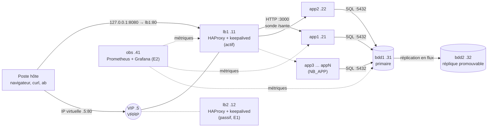

# RÉSULTATS-BF

Plateforme de consultation des résultats d'examens à partir du numéro de matricule. Elle est
**résiliente** (la panne d'une machine n'interrompt pas le service) et **scalable** (ajouter des
serveurs se fait en changeant une seule valeur). Toute l'infrastructure est décrite en code avec
**Vagrant + VirtualBox** et se reconstruit sans aucun geste manuel.

Projet de groupe, Virtualisation et Cloud Computing, M1 Informatique, IBAM, Université Joseph Ki-Zerbo
(Dr SOMDA, 2026-2027).

---

## Architecture



Réseau privé du groupe G : `192.168.(55+G).0/24` (plage imposée par VirtualBox ≥ 6.1.28).

| Machine | IP | RAM | Rôle | Statut |
|---|---|---|---|---|
| lb1 | `.11` | 512 Mo | Répartiteur HAProxy actif | obligatoire |
| lb2 | `.12` | 512 Mo | Répartiteur passif, IP virtuelle `.5` (VRRP) | extension E1 |
| app1 … appN | `.21` … `.2N` | 512 Mo | Service HTTP sans état (port 3000) | obligatoire, N ≥ 2 |
| bdd1 | `.31` | 768 Mo | PostgreSQL primaire | obligatoire |
| bdd2 | `.32` | 768 Mo | Réplique en flux, promouvable | obligatoire |
| obs | `.41` | 768 Mo | Prometheus + Grafana | extension E2 |

**Source unique de vérité** : la table `NOEUDS` du `Vagrantfile` crée les machines **et** engendre
`config/plateforme.json`. HAProxy, keepalived, `/etc/hosts` et Prometheus sont configurés à partir de
ce fichier. Aucune adresse n'est écrite en dur ailleurs.

---

## Prérequis

**Guide complet, avec les commandes d'installation : [docs/INSTALLATION.md](docs/INSTALLATION.md).**

| Outil | Version (testée) | Remarque |
|---|---|---|
| VirtualBox | **7.2.6** | Activer la virtualisation (VT-x/AMD-V) dans le BIOS |
| Vagrant | **2.4.9** | Couple VirtualBox/Vagrant validé le 23/10/2026 |
| Git (Git Bash) | dernière | Git Bash fournit `bash`, `curl`, `sed`, `awk` pour les scripts de `tests/` |
| Apache Bench `ab` | 2.4 | Scénario V3 uniquement (voir le guide) |
| Mémoire | 8 Go minimum | Socle seul ≈ 3 Go ; avec E1 + E2 ≈ 4,3 Go |

Rien n'est à installer dans les machines virtuelles : tout est fait par les scripts de provisionnement.

La boîte `bento/ubuntu-24.04` (version épinglée `202510.26.0`) est téléchargée automatiquement au
premier lancement (≈ 1 Go). Aucun compte cloud ni ressource payante n'est nécessaire.

---

## Démarrage rapide

```bash
git clone https://github.com/PorgoAbdoulNassirou/Projet-Virtualisation-Cloud.git resultats-bf
cd resultats-bf
vagrant up
```

C'est tout. Au premier lancement, le fichier `.env` est créé automatiquement à partir de
`.env.exemple`, avec des mots de passe aléatoires.

Vérification :

```bash
curl http://localhost:8080/info                          # via lb1
curl http://192.168.59.5/info                            # via l'IP virtuelle
curl "http://192.168.59.5/resultat?matricule=BF000123"
curl -sI http://192.168.59.5/info | grep -i x-serveur    # serveur qui a répondu
```

Statistiques du répartiteur : `http://192.168.59.11:8404/stats`
(groupe 04 : réseau `192.168.59.0/24`).

---

## Paramètres (`.env`)

| Variable | Défaut | Rôle |
|---|---|---|
| `GROUPE` | 4 | Numéro de groupe (1 à 8), qui fixe le réseau `192.168.(55+G).0/24` |
| `NB_APP` | 2 | Nombre de serveurs applicatifs (2 à 9) |
| `E1_LB2` | 1 | 1 = crée lb2 et l'IP virtuelle VRRP |
| `E2_OBS` | 1 | 1 = crée la machine de supervision |
| `PORT_HOTE` | 8080 | Port de l'hôte redirigé vers lb1:80 |
| `PG_MDP_*`, `VRRP_MDP`, `GRAFANA_MDP` | aléatoires | Secrets, jamais versionnés |

Une variable du shell l'emporte sur le `.env` : `NB_APP=4 vagrant up`.
Pendant le développement, mettre `E1_LB2=0` et `E2_OBS=0` pour économiser la mémoire.

---

## Exploitation

| Action | Commande |
|---|---|
| Construire ou démarrer toute la plateforme | `vagrant up` |
| Reconstruire de zéro (R1) | `vagrant destroy -f && vagrant up` |
| Passer à 4 serveurs applicatifs (R3) | changer `NB_APP=4` dans `.env`, puis `vagrant up` |
| Revenir à 2 serveurs | `vagrant destroy -f app3 app4`, puis `NB_APP=2` dans `.env`, puis `vagrant up` |
| Rejouer le provisionnement (R2) | `vagrant provision` (deux fois : aucun changement la seconde fois) |
| Bascule de la base (R6) | `time vagrant ssh bdd2 -c "sudo bash /vagrant/scripts/bascule_bdd.sh"` |
| Remettre bdd1 en service après une bascule | `vagrant up bdd1` : elle redevient automatiquement réplique de bdd2 (`reintegrer_bdd.sh`) |
| Vérifier R2, R3, R4, R8 | `bash tests/verifier_repartition.sh tout` |
| État des machines | `vagrant status` |
| Se connecter à une machine | `vagrant ssh lb1` |

**Comment l'ajout d'un serveur se propage** : `vagrant up` crée les nouvelles machines, puis rejoue le
provisionnement des répartiteurs (`run: "always"`). Ceux-ci réengendrent `haproxy.cfg` depuis
`plateforme.json` et rechargent HAProxy **sans couper** les connexions en cours.

---

## Scénarios de validation

Les scripts sont dans `tests/` et se lancent depuis l'hôte (voir `tests/README.md`). Les résultats bruts
sont enregistrés dans `tests/resultats/`.

| N° | Scénario | Commande |
|---|---|---|
| V1 | Répartition | `bash tests/v1_repartition.sh` |
| V2 | Panne d'un serveur applicatif | `bash tests/v2_panne_app.sh` |
| V3 | Montée en charge N=2 / N=4 | `bash tests/v3_montee_charge.sh` |
| V4 | Panne de la base primaire + bascule | `bash tests/v4_panne_bdd.sh` |
| V5 | Reconstruction complète | `bash tests/v5_reconstruction.sh` |
| V6 | Panne du répartiteur (E1) | `bash tests/v6_panne_lb.sh` |

---

## Structure du dépôt

```
resultats-bf/
├── Vagrantfile              # table NOEUDS = source unique de vérité
├── .env.exemple             # modèle de configuration (le .env n'est jamais versionné)
├── .gitattributes           # force LF (les scripts CRLF échouent dans les VM)
├── app/                     # service HTTP (Python, < 100 lignes)
├── config/                  # plateforme.json / noeuds.yml engendrés, grafana/
├── scripts/
│   ├── lib.sh               # fonctions communes (apt groupé, idempotence, attente)
│   ├── plateforme.py        # lecture de config/plateforme.json
│   ├── commun.sh            # socle de toutes les machines
│   ├── lb.sh                # HAProxy + keepalived
│   ├── generer_config_lb.py # haproxy.cfg et keepalived.conf engendrés
│   ├── app.sh               # déploiement du service applicatif
│   ├── bdd.sh / replique.sh # PostgreSQL primaire / réplique
│   ├── bascule_bdd.sh       # procédure de bascule chronométrée
│   ├── reintegrer_bdd.sh    # remise en service de l'ancien primaire comme réplique
│   └── obs.sh               # Prometheus + Grafana
├── tests/                   # scénarios V1 à V6 et résultats bruts
└── docs/                    # installation, plan de travail, démonstration, dossier et journal (.md, .docx, .pdf)
```

---

## Dépannage

| Symptôme | Cause probable et solution |
|---|---|
| `The IP address configured for the host-only network is not within the allowed ranges` | `GROUPE` hors de 1 à 8 : corriger `.env` |
| `/usr/bin/env: 'bash\r': No such file or directory` | Script enregistré en CRLF : `git config --global core.autocrlf false`, puis recloner |
| `Vagrant cannot forward the specified ports … 8080` | Port occupé sur l'hôte : changer `PORT_HOTE` dans `.env` |
| VirtualBox très lent sous Windows | Hyper-V/WSL2 actif (ex. Docker Desktop) : VirtualBox fonctionne, mais plus lentement |
| Le provisionnement attend « Could not get lock » | unattended-upgrades tourne au démarrage : `installer_paquets` patiente jusqu'à 5 min |
| HAProxy renvoie 503 | Aucune application ne répond 200 sur `/sante` : `vagrant ssh app1 -c "curl -s localhost:3000/sante"` |
| `timeout during server version negotiating` | VM figée, souvent faute de RAM sur l'hôte : `vagrant reload <machine>`, fermer les applications lourdes, `E2_OBS=0` pendant le développement |
| `vagrant upload f /tmp/x` envoie au mauvais endroit (Git Bash) | Git Bash convertit les chemins : `MSYS_NO_PATHCONV=1 vagrant upload …` |
| Après `NB_APP=4`, `vagrant ssh app3` répond « machine not found » | Toute commande doit voir la même valeur : mettre `NB_APP=4` dans `.env` plutôt que dans le shell |

---

## Équipe

| Membre | Rôle |
|---|---|
| PORGO Abdoul Nassirou | Architecte réseau et répartition (Vagrantfile, HAProxy, E1) |
| KOBENDE Pêgdwendé Evrard | Ingénieur applicatif (service HTTP, E4) |
| OUEDRAOGO Armand Hendrix | Ingénieur données (PostgreSQL, réplication, bascule, E3) |
| THIOMBIANO Yempabou Romaric Johan | Ingénieur essais et observabilité (V1 à V6, E2) |

Répartition détaillée : [docs/PLAN_DE_TRAVAIL.md](docs/PLAN_DE_TRAVAIL.md). Livrables : [docs/dossier_architecture.pdf](docs/dossier_architecture.pdf), [docs/journal_de_bord.pdf](docs/journal_de_bord.pdf). Démonstration : [docs/DEMONSTRATION.md](docs/DEMONSTRATION.md).
