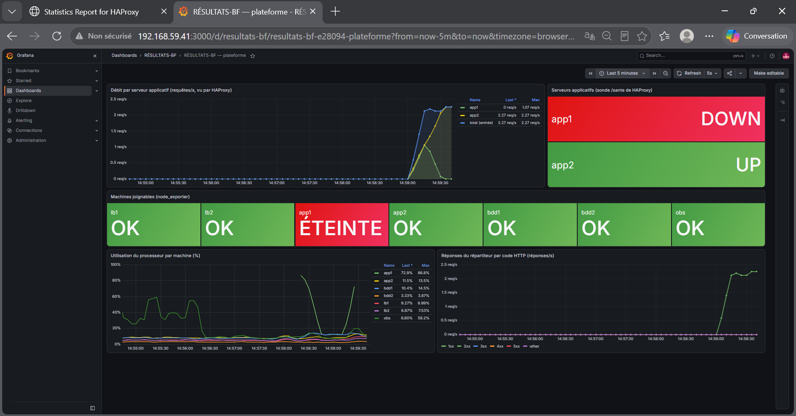
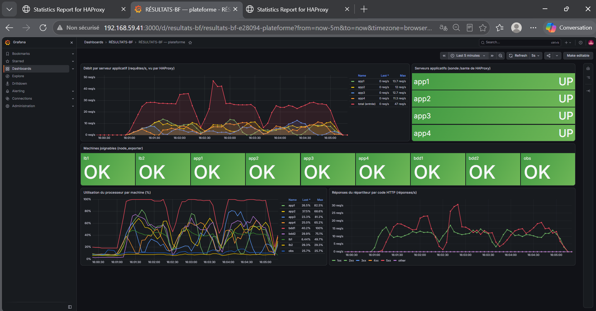
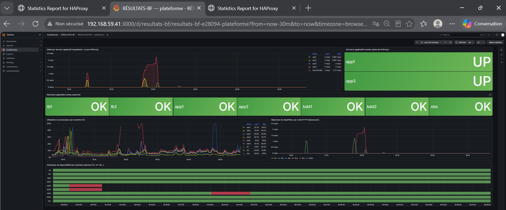

Dépôt : <https://github.com/PorgoAbdoulNassirou/Projet-Virtualisation-Cloud>. Réseau du groupe :
`192.168.59.0/24`. Chaque section indique son rédacteur ; chaque chiffre renvoie à un fichier brut de
`tests/resultats/`.

---

## 1. Contexte et exigences (THIOMBIANO)

Chaque année, la publication des résultats d'examens provoque le même incident : le site tombe dans les
minutes qui suivent l'annonce. Le programme n'est presque jamais en cause. C'est l'infrastructure, qui
n'a été pensée ni pour absorber un pic de consultations, ni pour survivre à la panne d'une seule machine.
RÉSULTATS-BF permet à un candidat de consulter son résultat à partir de son matricule. L'application
(trois points d'entrée, moins de 100 lignes) est volontairement minuscule : ce qui est évalué, c'est
l'infrastructure autour d'elle et la preuve, chiffrée, qu'elle tient.

Deux exigences non fonctionnelles priment, et chacune se traduit en choix d'architecture concrets :

| Exigence | Ce qu'elle impose | Choix retenus |
|---|---|---|
| **Résilience** : la panne d'une machine n'interrompt pas le service | Aucun point de défaillance unique sur le chemin d'une requête | N ≥ 2 serveurs applicatifs **sans état** derrière HAProxy, qui ne leur envoie du trafic que s'ils répondent sur `/sante` (R4) ; répartiteur doublé avec une IP virtuelle VRRP (E1) ; base répliquée en flux, avec une bascule écrite et chronométrée (R5, R6) |
| **Scalabilité** : absorber plus de trafic en ajoutant des machines, sans réécrire la configuration | Le nombre de serveurs est **un paramètre** ; tout ce qui en dépend est **engendré** | `NB_APP` dans `.env` ; la table `NOEUDS` du `Vagrantfile` est la source unique de vérité dont sont engendrés HAProxy, keepalived, `/etc/hosts` et les cibles Prometheus (R3) |

S'y ajoutent les exigences de qualité : la plateforme se reconstruit **sans aucun geste manuel**
(`vagrant destroy -f && vagrant up`, R1), le provisionnement est **idempotent** (R2), aucun secret
n'est versionné (R7), et seul le répartiteur expose un port vers l'hôte (R8). Enfin, **on mesure plutôt
qu'on affirme** : chaque chiffre de ce dossier renvoie à un fichier brut de `tests/resultats/`,
produit par un script de `tests/` que chacun peut rejouer.

## 2. Architecture (PORGO)

### 2.1 Vue d'ensemble

Le client (navigateur, `curl`, `ab`) s'adresse à une **IP virtuelle** `192.168.59.5` portée par l'un
des deux répartiteurs HAProxy (lb1 actif, lb2 passif), qui se la transmettent par VRRP (keepalived).
Le répartiteur distribue les requêtes, en tourniquet, aux N serveurs applicatifs sans état ; ceux-ci lisent
la base PostgreSQL primaire bdd1, répliquée en flux vers bdd2. La machine obs collecte les métriques
(extension E2). Le schéma est celui du README.

| Machine | IP | RAM | Rôle | Statut |
|---|---|---|---|---|
| (IP virtuelle) | 192.168.59.5 | – | Adresse du service, portée par lb1 ou lb2 | E1 |
| lb1 | 192.168.59.11 | 512 Mo | HAProxy 2.8 + keepalived, actif (priorité 150) | obligatoire |
| lb2 | 192.168.59.12 | 512 Mo | HAProxy 2.8 + keepalived, passif (priorité 100) | E1 |
| app1 … appN | 192.168.59.21 … .2N | 512 Mo | Service HTTP sans état, port 3000 | obligatoire |
| bdd1 | 192.168.59.31 | 768 Mo | PostgreSQL primaire | obligatoire |
| bdd2 | 192.168.59.32 | 768 Mo | Réplique en flux, promouvable | obligatoire |
| obs | 192.168.59.41 | 768 Mo | Prometheus + Grafana | E2 |

Socle obligatoire : 5 VM, 3 072 Mo. Avec E1 et E2 : 4 352 Mo.

### 2.2 Plan d'adressage

Depuis VirtualBox 6.1.28, les réseaux hôte-seul ne sont autorisés par défaut que dans
`192.168.56.0/21`. Le groupe 04 utilise donc `192.168.(55+4).0/24 = 192.168.59.0/24`, sans toucher
à `/etc/vbox/networks.conf` (ce qui rendrait le dépôt non reproductible). Les dizaines codent le rôle :
`.1x` répartition, `.2x` applications, `.3x` données, `.4x` supervision, `.5` IP virtuelle.
`NB_APP` est donc borné à 9 (`.21` à `.29`) pour ne jamais empiéter sur les bases.

### 2.3 Source unique de vérité (R3)

La table `NOEUDS` du `Vagrantfile` est la **seule** description de l'infrastructure. À chaque commande
`vagrant`, elle est sérialisée dans `config/plateforme.json` (et `config/noeuds.yml`), que les VM lisent
dans `/vagrant/config/` via `scripts/plateforme.py`. En découlent automatiquement :
la configuration HAProxy (liste des serveurs), keepalived (pairs VRRP, interface, IP virtuelle),
`/etc/hosts` de chaque machine et les cibles Prometheus. **Aucune adresse n'est écrite en dur** dans
un script ou une configuration.

### 2.4 Cloisonnement réseau (R8)

Tout le trafic interne passe par le réseau privé `192.168.59.0/24`. Le seul port redirigé vers l'hôte est
`127.0.0.1:8080 → lb1:80` (lié à la boucle locale : invisible depuis le réseau de la salle). Les ports
SSH (2222, 2200…) sont ceux que Vagrant ajoute pour son propre accès. La page de statistiques HAProxy
(`:8404`) n'écoute que sur l'IP privée du répartiteur.

## 3. Justification des choix

### 3.1 Répartition : HAProxy (PORGO)

| Besoin | Réponse HAProxy | Pourquoi pas Nginx |
|---|---|---|
| R4 : n'envoyer du trafic qu'aux serveurs sains | **Sonde active** `GET /sante` toutes les secondes (`option httpchk`, `http-check expect status 200`) | Nginx libre ne fait que des contrôles **passifs** (il découvre la panne sur une requête d'utilisateur) ; les sondes actives sont réservées à Nginx Plus |
| V2 : aucune erreur visible quand un serveur tombe | `retry-on conn-failure empty-response response-timeout` + `option redispatch` : la requête est rejouée sur un autre serveur | Possible (`proxy_next_upstream`) mais sans sonde active |
| R3 : ajouter des serveurs sans coupure | `systemctl reload` : nouveau processus, connexions en cours conservées | Équivalent |
| Observer la répartition | En-tête `X-Serveur`, page de stats, exportateur Prometheus intégré (`+PROMEX`) | Statistiques limitées en version libre |

**Calcul du délai d'éviction (R4).** `inter 1s` (une sonde par seconde), `fall 2` (deux échecs
consécutifs). Pour une sonde, HAProxy borne la **connexion** par `timeout connect` (1 s) et la **lecture**
de la réponse par `timeout check` (3 s). Pire cas pour une panne franche (VM éteinte, service arrêté,
connexion refusée) : 1 s (attente de la sonde) + 2 × 1 s ≈ 3 s, donc moins de 5 s. **Mesuré : 1,04 s avec
l'application de test, 1,39 s avec l'application finale** (§ 6). `rise 2` évite qu'un serveur instable soit
réintégré sur un seul succès.

**Pourquoi 3 s de lecture et non 1 s** (correction du 23/10, trouvée au test d'intégration de la bascule) :
après la bascule, bdd1 est éteinte et libpq essaie d'abord bdd1 avant bdd2, si bien que `/sante` répond
200 en 0,6 à 2,1 s. Avec `timeout check 1s`, la sonde déclarait ces serveurs **sains** hors service
(`L7TOUT`) et le service restait en 503 après une bascule pourtant réussie. **Compromis assumé** : un
serveur *gelé* (qui accepte la connexion mais ne répond plus) serait écarté en 1 + 2 × 3 ≈ 7 s au pire, au-delà
des 5 s ; ce cas n'entre pas dans les scénarios V2/V4, et le rejeu `retry-on response-timeout` protège tout de
même les requêtes des utilisateurs. Le détour par l'hôte éteint ne dure que jusqu'à la remise en service de
bdd1 comme réplique (§ 5.3) : `/sante` répond alors en 0,33 s.

La configuration est **engendrée** par `scripts/generer_config_lb.py` puis validée par `haproxy -c`
**avant** d'être installée : une erreur arrête le provisionnement au lieu de casser un répartiteur en service.

### 3.2 Application sans état, connexion multi-hôtes `target_session_attrs` (KOBENDE)

Le service (`app/app.py`, 87 lignes) n'utilise que la bibliothèque standard (`ThreadingHTTPServer`) et
`psycopg2`, installé par apt (`python3-psycopg2`) : aucun `pip`, donc aucun téléchargement imprévisible
pendant le provisionnement.

| Besoin | Choix dans l'application | Pourquoi |
|---|---|---|
| R3 / V2 : n'importe quel serveur peut répondre | **Aucun état** : ni session, ni fichier, ni compteur ; une connexion à la base par requête, toujours refermée (`finally`) | HAProxy peut envoyer chaque requête, ou la rejouer, sur n'importe quel serveur ; ajouter ou perdre un serveur ne perd aucune donnée |
| V4 : survivre à la bascule de la base sans rien modifier | `host=<bdd1>,<bdd2>` et `target_session_attrs=read-write` | libpq essaie les hôtes dans l'ordre et ne garde que celui qui **accepte les écritures**. Avant la bascule, c'est bdd1 ; bdd1 éteinte, bdd2 encore réplique est refusée, donc `/sante` = 503 ; après `pg_promote()`, la même chaîne trouve bdd2 et `/sante` repasse à 200, sans redémarrer l'application |
| R4 : la sonde de HAProxy doit dire la vérité | `/sante` exécute un vrai `SELECT 1` ; 200 seulement s'il réussit | Un serveur dont la base est perdue est retiré de la répartition au lieu de renvoyer des erreurs aux utilisateurs |
| Réponse rapide même si la base est morte | `connect_timeout=2` et `statement_timeout=2000` | Une requête n'attend jamais indéfiniment : la sonde reçoit sa réponse sous les 5 s exigées (503 mesuré en 2,1 s sans base) |
| Pas de trace brute visible | Toute `psycopg2.Error` devient un JSON `503` ; requête SQL paramétrée (`%s`) | Erreurs propres pour l'utilisateur ; protection contre l'injection SQL sur le matricule |
| Démarrer avant la base | La connexion n'est ouverte qu'à la requête | Le service démarre même si bdd1 n'est pas prête : il répond 503 puis 200 dès que la base est là |

**Déploiement** (`scripts/app.sh`) : `app.py` est copié dans `/opt/resultats-bf/` (on n'exécute jamais
depuis le dossier synchronisé `/vagrant`). La configuration `/etc/resultats-bf/app.env` est construite
avec `plateforme ip bdd1` / `plateforme ip bdd2` (aucune adresse en dur, R3) et `$PG_MDP_APP` venu du
`.env` (aucun secret versionné, R7) ; elle est en mode **600**, propriété de root : systemd la lit avant de
lancer le service. Le service systemd `resultats-app` tourne sous un **utilisateur système dédié**, non
root, avec `ProtectSystem=strict`, et `Restart=always` le relance en 1 s s'il s'arrête. Chaque fichier
passe par `installer_si_change` : le service n'est redémarré que si `app.py`, `app.env` ou l'unité ont
réellement changé, ce qui rend le script idempotent (R2).

### 3.3 PostgreSQL et réplication en flux, choix asynchrone et son RPO (OUEDRAOGO)

| Besoin | Choix | Pourquoi |
|---|---|---|
| Un volume de données réaliste pour les mesures | Table `resultats(matricule PK, nom, serie, moyenne, admis)`, **50 000 lignes** engendrées par `generate_series` (matricules `BF000001` à `BF050000`, moyenne déterministe entre 0 et 20) | Même jeu de données à chaque reconstruction (R1) ; insertion en `ON CONFLICT DO NOTHING` : rejouable (R2) |
| R5 : une seconde copie toujours à jour | **Réplication physique en flux** (`pg_basebackup -R -X stream` depuis bdd1) | Mécanisme natif de PostgreSQL 16, sans logiciel supplémentaire ; bdd2 est une copie exacte, promouvable par `pg_promote()` |
| Choix asynchrone | Réglage par défaut (`synchronous_standby_names` vide) | Une écriture n'attend pas bdd2 : bdd1 reste disponible même si bdd2 tombe. Le prix est un **RPO non nul** : les dernières transactions non encore transmises sont perdues si bdd1 tombe. Mesuré : une écriture sur le primaire est lue sur la réplique moins d'une seconde après (§ 5.3). Pour RÉSULTATS-BF, l'application ne fait que **lire** des données chargées au provisionnement : le RPO effectif est nul |
| Sécurité des accès | `pg_hba.conf` engendré : `app_resultats` (SELECT seulement) et `replicateur` (REPLICATION) acceptés uniquement depuis `192.168.59.0/24`, en `scram-sha-256` ; mots de passe passés par l'environnement | Moindre privilège ; aucun secret dans le dépôt (R7) ; aucun accès extérieur au réseau privé (R8) |
| Durabilité | Données dans `/var/lib/postgresql/16/main`, **jamais** dans `/vagrant` | Le dossier synchronisé de VirtualBox ne garantit ni les verrous ni `fsync` (piège connu de l'énoncé) |
| Ne jamais écraser une base à jour | Garde-fous : `replique.sh` ne recopie que si bdd2 n'a pas encore la base ; `bdd.sh` n'écrit rien sur une réplique | Le provisionnement reste rejouable même après une bascule (§ 5.3) |

### 3.4 Haute disponibilité du répartiteur : VRRP avec keepalived (PORGO)

Un répartiteur unique est un point de défaillance unique. lb1 et lb2 exécutent la même configuration
HAProxy ; keepalived (2.2.8) leur fait partager l'IP virtuelle `192.168.59.5` par VRRP :

- **Priorités** 150 (lb1) et 100 (lb2), engendrées depuis l'ordre de la table ; annonce toutes les secondes
  (`advert_int 1`). Si lb2 n'entend plus lb1 pendant ≈ 3 annonces, il prend l'IP et émet un ARP gratuit
  pour que l'hôte mette à jour son cache.
- **Suivi de HAProxy** (`vrrp_script` + `systemctl is-active haproxy`) : une machine dont HAProxy est
  arrêté abandonne l'IP, même si elle est allumée.
- **Unicast** (`unicast_peer`) plutôt que multicast : aucune dépendance au comportement du réseau hôte-seul.
- **Les deux en `BACKUP` avec `preempt_delay 10`** : au retour de lb1, il attend 10 s (HAProxy prêt) avant de
  reprendre l'IP ; vérifié (§ 6).
- Mot de passe VRRP lu dans `.env` (8 caractères maximum, limite de keepalived), fichier en mode 600.

L'IP virtuelle, et non `localhost:8080`, est l'adresse du service : la redirection de port de Vagrant passe
par la carte NAT de lb1 et disparaît avec lui.

### 3.5 Observabilité : Prometheus + Grafana, extension E2 (THIOMBIANO)

```
 node_exporter :9100, sur CHAQUE machine ──┐  CPU, mémoire, « la machine répond-elle ? »
 HAProxy lb1/lb2 :8404/metrics ────────────┤  débit et état UP/DOWN de chaque serveur applicatif
                                           ▼
                obs : Prometheus :9090     interroge toutes les cibles toutes les 5 s et stocke les séries
                                           ▼
                obs : Grafana :3000        tableau de bord « RÉSULTATS-BF — plateforme »
```

| Besoin | Choix | Pourquoi |
|---|---|---|
| Voir chaque machine | `prometheus-node-exporter` installé par `commun.sh` sur toutes les machines quand E2 est active (même appel apt que le socle) | Paquet Ubuntu, aucun téléchargement extérieur ; une machine éteinte se voit immédiatement (`up = 0`) |
| Voir la répartition et la santé vue par HAProxy | Exportateur Prometheus **intégré** à HAProxy (`/metrics`, déjà compilé dans le paquet) | Aucune pièce de plus : on lit directement le compteur de réponses et l'état de la sonde `/sante` de chaque serveur |
| Aucune adresse en dur (R3) | `prometheus.yml` **engendré** par `obs.sh` depuis `plateforme.json`, validé par `promtool check config` avant d'être installé ; le rôle obs est rejoué à chaque `vagrant up` (`run: "always"`, comme le répartiteur) | Avec `NB_APP=4`, app3 et app4 apparaissent seules dans Prometheus : mesuré, « Prometheus reconfiguré : 9 machine(s) », puis 7 au retour à N=2 |
| Tableau de bord reproductible (R1) | Source de données et tableau de bord **provisionnés par fichiers** (`config/grafana/`), sans aucun clic | Un `vagrant destroy` ne perd rien : le tableau de bord est du code versionné |
| Secret (R7) | Mot de passe admin `GRAFANA_MDP` lu dans `.env`, fichier d'environnement en mode 600 | Aucun mot de passe dans le dépôt |
| Cloisonnement (R8) | Grafana et Prometheus joignables seulement sur l'IP privée de obs, aucun port redirigé | Seul le répartiteur expose un port vers l'hôte |

**Le tableau de bord** compte six panneaux : débit par serveur (réponses/s comptées par HAProxy) ;
état de chaque serveur selon la sonde `/sante` ; machines joignables ; CPU par machine ; réponses par
code HTTP (2xx en vert, 5xx en rouge) ; **historique de disponibilité** (frise, une ligne par machine),
qui garde la trace des pannes provoquées par les scénarios. Les captures C2 à C6b (§ 6) en sont issues.

**Difficulté rencontrée.** Au premier déploiement, Grafana 13 a mis **10 minutes** à démarrer, et le
provisionnement a échoué au bout du délai d'attente (`tests/resultats/e2_obs_20261024_123257.log`).
Son journal montrait qu'il chargeait une douzaine de sources de données intégrées (Loki, MySQL,
Elasticsearch…), chacune comme **un processus séparé** : les 768 Mo de obs saturaient, au point que le
noyau tuait des services système. Correction : `GF_PLUGINS_DISABLE_PLUGINS` (on ne garde que le plugin
Prometheus) et `GF_PLUGINS_PREINSTALL_DISABLED`. Le provisionnement suivant a pris **1 min 08 s**, et
le rejeu suivant n'a rien changé (« Prometheus inchangé », « Grafana inchangé » : R2).

### 3.6 Points de défaillance unique supprimés, et ceux qui restent (tous)

| Composant | Avant | Après |
|---|---|---|
| Répartiteur | lb1 seul | lb1 + lb2, IP virtuelle VRRP (E1) |
| Serveur applicatif | — | N ≥ 2, sonde de santé, rejeu des requêtes |
| Base de données | bdd1 seule | bdd1 + réplique en flux bdd2, bascule chronométrée (≈ 3 s), réintégration automatique de l'ancien primaire |

**Points de défaillance qui restent** : la bascule de la base est **manuelle** (il faut lancer
`bascule_bdd.sh`) ; l'hôte physique unique (toutes les VM sur un seul ordinateur) ; le réseau hôte-seul
unique ; la machine de supervision obs (sa perte n'interrompt pas le service).

## 4. Reproductibilité et qualité (PORGO)

- **R1, reconstruction.** Sur un clone neuf, `vagrant up` suffit : le `.env` absent est créé à partir de
  `.env.exemple` avec des mots de passe aléatoires (`SecureRandom`), la box est épinglée
  (`bento/ubuntu-24.04` `202510.26.0`), et tout le reste est installé par les scripts. Premier `vagrant up`
  du socle mesuré : **1 433 s** (téléchargement de la box inclus) ; reconstruction complète
  (`vagrant destroy -f && vagrant up`, bases, application et répartiteurs) : **1 934 s**.
- **R2, idempotence.** Trois techniques : `installer_paquets` n'appelle apt que pour les paquets absents ;
  `installer_si_change` n'écrase un fichier (et ne recharge le service) que si son contenu a changé ;
  `/etc/hosts` est un bloc entre marqueurs réécrit à l'identique, jamais un `>>`. Vérifié par empreintes
  SHA-256 avant et après un second `vagrant provision` sur les 6 machines (§ 6).
- **R7, secrets.** Aucun mot de passe dans le dépôt : `.env` est ignoré par Git ; les valeurs passent aux
  scripts par l'option `env:` du provisionneur ; les fichiers qui les contiennent dans les VM sont en mode 600.
- **Fins de ligne.** `.gitattributes` impose LF : un script CRLF échouerait dans la VM (`bash\r`).
- **Connexion lente.** Un seul appel apt par script ; index rafraîchi au plus toutes les 6 h ;
  `DPkg::Lock::Timeout=300` absorbe le verrou d'unattended-upgrades au démarrage.

## 5. Procédures d'exploitation

### 5.1 Ajouter (ou retirer) des serveurs applicatifs (PORGO)

1. Mettre `NB_APP=4` dans `.env` (ou préfixer la commande : `NB_APP=4 vagrant up`).
2. `vagrant up` : Vagrant crée app3 et app4 (provisionnées par `app.sh`), puis rejoue le rôle des
   répartiteurs (`run: "always"`), qui réengendrent `haproxy.cfg` et rechargent HAProxy sans coupure.
3. Contrôle : `http://192.168.59.11:8404/stats` montre 4 serveurs UP.

Pour revenir à 2 : `NB_APP=4 vagrant destroy -f app3 app4`, remettre `NB_APP=2`, puis `vagrant up`.
Les deux sens ont été exécutés (§ 6).

### 5.2 Bascule de la base : `bascule_bdd.sh`, étapes et durée (OUEDRAOGO)

**Quand ?** bdd1 (primaire) est tombée : `/sante` renvoie 503 sur tous les serveurs applicatifs et HAProxy
renvoie un 503 JSON (`{"erreur": "aucun serveur applicatif disponible"}`), jamais une page blanche.

**Commande** (depuis l'hôte, à la racine du dépôt) :

```bash
time vagrant ssh bdd2 -c "sudo bash /vagrant/scripts/bascule_bdd.sh"
```

**Étapes du script** :

1. **Vérifier que l'ancien primaire est vraiment hors service** (tentative de connexion TCP de 2 s sur son
   port 5432). S'il répond encore, la promotion est **annulée** : promouvoir bdd2 à côté d'un bdd1 vivant
   créerait deux primaires.
2. **Promouvoir** bdd2 : `SELECT pg_promote(true, 60)` (seulement si elle est encore en récupération,
   donc rejouable sans effet).
3. **Attendre** que `pg_is_in_recovery()` renvoie `false` (120 s au maximum, sinon échec explicite).
4. **Afficher** l'heure de début, l'heure de fin et la durée.

Rien n'est à modifier côté application : sa chaîne de connexion `host=bdd1,bdd2 target_session_attrs=read-write`
trouve d'elle-même le nouveau primaire. Le script est symétrique : lancé sur bdd1, il la promeut à la place de bdd2.

**Mesures** :

| Mesure | Résultat | Fichier brut |
|---|---|---|
| Durée de la promotion (script) | **2 s** (OUEDRAOGO), puis **3 s** à chaque test d'intégration (PORGO) | `bdd_20261023.log`, `integration_bascule_20261023_164927.log`, `reintegration_bdd1_20261023_173638.log` |
| Retour du service après la fin de la bascule | **5,1 s** : HAProxy attend 2 sondes réussies (`rise 2`, `downinter 2s`) | `integration_bascule_20261023_164927.log` |
| Commande complète vue de l'hôte | ≈ 10 s, dont ≈ 7 s d'établissement de la session `vagrant ssh` | idem |

**Après la bascule** : remettre bdd1 en service (§ 5.3).

### 5.3 Remise en service de bdd1 comme nouvelle réplique (PORGO, pour OUEDRAOGO)

**Le problème.** Après une bascule, bdd2 est primaire. Quand on rallume bdd1, systemd relance PostgreSQL
**en primaire** : il y a deux primaires (« cerveau divisé »). Comme la chaîne de connexion des applications
essaie bdd1 en premier, elles liraient l'ancienne base, à laquelle il manque tout ce qui a été écrit depuis la
panne. Deuxième danger : rejouer `replique.sh` sur bdd2 promue l'aurait **effacée** pour la recopier depuis
l'ancien primaire.

**La procédure : une seule commande, `vagrant up bdd1`.** Le provisionneur `reintegrer`
(`scripts/reintegrer_bdd.sh`, rejoué à chaque `vagrant up` des deux bases) fait le travail :

1. Si la machine est déjà une réplique (`standby.signal`), ou si l'autre base est injoignable, il ne fait rien.
2. Il compare les **lignes de temps** PostgreSQL : la sienne (`pg_controldata`) et celle de l'autre base
   (commande de réplication `IDENTIFY_SYSTEM`). Chaque promotion incrémente la ligne de temps : si l'autre
   est plus récente, cette machine est l'ancien primaire.
3. Dans ce seul cas : arrêt de PostgreSQL, effacement des données périmées, `pg_basebackup -R` depuis
   le nouveau primaire, redémarrage en réplique, et vérification que le flux est bien reçu (`streaming`).

Le script est **symétrique** (il sert aussi si bdd2 tombe à son tour), comme `bascule_bdd.sh`, qui promeut
désormais la machine où on le lance. Deux garde-fous complètent la procédure : `bdd.sh` n'écrit plus rien si
bdd1 est réplique, et `replique.sh` refuse de réinitialiser bdd2 si elle contient déjà la base (promue).

**Mesures** (fichier `reintegration_bdd1_*.log`) :

| Étape | Résultat |
|---|---|
| État nominal, `--provision-with reintegrer` sur bdd1 | « primaire à jour (ligne de temps 1, bdd2 : 1) » : rien fait |
| Bascule (`halt bdd1` puis `bascule_bdd.sh` sur bdd2) | 3 s |
| Écriture sur bdd2 pendant que bdd1 est éteinte | ligne `REPRISE01` insérée |
| `vagrant up bdd1` | ancien primaire détecté (ligne de temps 1 < 2), **converti en réplique en 39 s** ; commande complète 208 s (démarrage de la VM compris) |
| Données | `REPRISE01` présente sur bdd1 ; nouvelle écriture sur bdd2 lue sur bdd1 1 s après ; 50 002 lignes de chaque côté |
| Service | `/sante` 200 en 0,33 s (contre ≈ 2 s tant que bdd1 était éteinte : libpq écarte vite une réplique joignable) |
| R2 après bascule | `vagrant provision` ×2 sur bdd1 (réplique) et bdd2 (primaire) : 4 × code 0, aucune écriture, aucune réinitialisation |

**Limite connue, mesurée.** Entre le démarrage de la VM et le passage du provisionneur, bdd1 tourne en
primaire périmé pendant **42,7 s** (journal systemd : démarrage 17:41:07,3, arrêt 17:41:50,1). Pendant
cette fenêtre, une application peut lire des données périmées ; elle ne peut pas créer d'écritures
divergentes, car le service est en lecture seule. Amélioration possible : une condition de démarrage
systemd (`ExecStartPre`) sur PostgreSQL qui fasse la même comparaison des lignes de temps **avant** de
démarrer, ce qui fermerait la fenêtre.

### 5.4 Panne et retour d'un répartiteur (PORGO)

- **Panne de lb1** : rien à faire. lb2 prend l'IP virtuelle en moins de 2 s (mesuré).
- **Retour** : `vagrant up lb1`. Le rôle est rejoué (sans changement), keepalived redémarre ; 10 s plus tard
  lb1 reprend l'IP (priorité supérieure). Vérification : `vagrant ssh lb1 -c "ip -4 addr show eth1"` montre
  `192.168.59.5`.
- **Panne de HAProxy seul** sur lb1 (machine allumée) : le `vrrp_script` la détecte et l'IP passe à lb2.
  Mesuré : `systemctl stop haproxy` sur lb1, lb2 entre en état MASTER **2,59 s** plus tard (journal
  keepalived, horloges des deux VM), le service reste joignable (200) ; au redémarrage de HAProxy, lb1
  reprend l'IP.

## 6. Résultats des scénarios (THIOMBIANO + responsables)
Pour chaque scénario : **commande exacte**, **résultat brut** (renvoi au fichier de `tests/resultats/`), **tableau**, **commentaire honnête**.

Les scénarios V1 à V5 ont été mesurés le 24/10 sur le poste de THIOMBIANO (Intel Core i7-1185G7,
4 cœurs / 8 threads, 15,7 Go de RAM, Windows 11 Professionnel, VirtualBox 7.2.6, Vagrant 2.4.9),
plateforme complète avec E1 et E2 (7 machines virtuelles, 1 vCPU chacune). V6 et les vérifications
R2 à R8 l'ont été le 23/10 sur le poste de PORGO (même modèle de processeur, génération voisine).

| Scénario | Mesure attendue | Résultat | Fichier brut |
|---|---|---|---|
| V1 répartition | écart < 20 % | **N = 2 : 10 / 10 ; N = 4 : 5 / 5 / 5 / 5 ; écart 0 %**, aucun échec | `v1_20261024_140111.log`, `v1_20261024_155856.log`, `v1_20261024_161201.log` |
| V2 panne app1 | requêtes perdues, durée dégradée | **0 perdue, 0 dégradée**, sur trois mesures : 81 (PORGO), 139 et 132 requêtes (THIOMBIANO) | `v2_20261023_163047.log`, `v2_20261024_142807.log`, `v2_20261024_145903.log` |
| V3 charge N=2 / N=4 | req/s | **Débit utile (réponses 200/s) : 15,7 avec N = 2, 12,3 avec N = 4** ; ab annonce 26,5 et 26,2 req/s, mais 41 % puis 53 % des réponses sont des 503 : la base est le goulot | `v3_N2_20261024_151124.log`, `v3_N4_20261024_160100.log` |
| V4 panne bdd1 | durée de la bascule | **503 JSON propre pendant la panne, 0 réponse brute sur 160 sondes ; promotion 3 s ; service rétabli 3 à 5 s après la bascule** ; bdd1 redevenue réplique en 25 s | `v4_20261024_161821.log`, `v4_20261024_161821_sonde.log` |
| V5 reconstruction | durée totale | **1 778 s (29 min 38 s)** pour les 7 machines, E1 et E2 comprises ; aucune commande ensuite, 0 erreur, `/sante` et `/resultat` en 200 | `v5_20261024_164401.log`, `v5_20261024_164401_vagrant.log` |
| V6 panne lb1 | temps de reprise VRRP | **Application finale : 1 requête perdue sur 124, interruption réelle 1,70 s** ; rejoué sur le poste de THIOMBIANO : 1/114 en 1,74 s. Application de test : 1/122 en 1,73 s, 1/130 en 1,68 s | `v6_20261023_163244.log`, `v6_20261024_182157.log`, `v6_20261023_104601.log`, `v6_20261023_104251.log` |

### 6.1 V1 : répartition (THIOMBIANO)

**Commande** : `bash tests/v1_repartition.sh` (20 appels successifs à `http://192.168.59.5/info`).
Le serveur qui a répondu est lu dans l'en-tête `X-Serveur` posé par HAProxy. La liste des serveurs
attendus vient de `plateforme.json` : un serveur qui ne répondrait jamais compterait pour 0 au lieu
d'être oublié. **Écart** = (plus sollicité − moins sollicité) / part attendue (20 / N).

| N | Répartition | Écart | Ordre observé |
|---|---|---|---|
| 2 | app1 10, app2 10 | **0 %** | alternance stricte app2, app1, app2… |
| 4 | app1 5, app2 5, app3 5, app4 5 | **0 %** | cycle strict app1 → app2 → app3 → app4, répété 5 fois |

**Commentaire** : c'est le comportement attendu de `balance roundrobin` avec des appels successifs et
des serveurs tous sains. L'écart nul ne prouverait rien sous charge concurrente ; il prouve ici que tous
les serveurs déclarés reçoivent du trafic, y compris app3 et app4 ajoutés par `NB_APP=4` (R3). Capture
**C5b** : page de statistiques HAProxy, 4 serveurs UP, 5 sessions chacun.

### 6.2 V2 : panne d'un serveur applicatif (KOBENDE, mesures PORGO et THIOMBIANO)

**Commande** : `DUREE=60 bash tests/v2_panne_app.sh` (une requête toutes les 200 ms sur l'IP
virtuelle, `vagrant halt app1` à t = 5 s).

| Mesure | Requêtes | Perdues | Dégradées (> 0,5 s) | app1 répond encore après l'ordre d'arrêt |
|---|---|---|---|---|
| 23/10 (PORGO) | 81 | 0 | 0 | 13,1 s |
| 24/10 14:28 | 139 | 0 | 0 | 13,2 s |
| 24/10 14:59 | 132 | 0 | 0 | 9,6 s |

**Commentaire** : la panne est invisible pour les utilisateurs, dans les trois mesures. `vagrant halt`
éteint app1 proprement ; pendant ce temps elle sert encore. Dès qu'elle cesse de répondre, la sonde
l'écarte et `retry-on` + `redispatch` rejouent sur app2 les requêtes déjà parties vers elle. Capture
**C3** : app1 DOWN et ÉTEINTE, la courbe d'app2 prend tout le débit, aucune réponse 5xx.

{width=100%}

### 6.3 V3 : montée en charge, N = 2 puis N = 4 (THIOMBIANO)

**Commande** : `bash tests/v3_montee_charge.sh`, qui exécute 3 tirs de
`ab -l -n 2000 -c 50 http://192.168.59.5/resultat?matricule=BF000123` après un échauffement non
compté, 10 s de pause entre deux tirs ; on retient le tir médian. Entre les deux séries : `NB_APP=4`
dans `.env`, puis `vagrant up` (4 min 22 s, app3 et app4 créées, HAProxy et Prometheus reconfigurés
seuls). `ab` compte les 503 dans son « Requests per second » : le script calcule donc aussi le
**débit utile**, en réponses 200 par seconde.

| Tir | N = 2 : req/s (ab) | N = 2 : réponses 200/s | N = 2 : non-2xx | N = 4 : req/s (ab) | N = 4 : réponses 200/s | N = 4 : non-2xx |
|---|---|---|---|---|---|---|
| 1 | 25,91 | 14,78 | 43,0 % | 28,96 | 11,86 | 59,0 % |
| 2 | 26,49 | 15,68 | 40,8 % | 30,32 | 13,23 | 56,4 % |
| 3 | 37,35 | 17,42 | 53,4 % | 26,25 | 12,35 | 53,0 % |
| **Médiane** | **26,5** | **15,7** | **40,8 %** | **26,2** | **12,3** | **53,0 %** |
| Temps de réponse médian | 1,5 à 1,9 s | | | 1,7 à 1,8 s | | |

**Le débit n'augmente pas avec N : le débit utile baisse de 22 %.** Ce n'est pas une erreur de mesure,
c'est le résultat, et il s'explique :

1. **Le goulot est la base, pas les serveurs applicatifs.** Pendant chaque tir, bdd1 (1 vCPU) est à
   **100 %** de CPU, alors que les serveurs applicatifs restent entre 50 et 90 % (captures **C4** et **C5**).
2. **Chaque requête ouvre une connexion PostgreSQL neuve** (choix « sans état, sans pool », § 3.2) :
   nouveau processus serveur et authentification SCRAM-SHA-256 (4 096 itérations de hachage), à chaque
   fois. Une connexion coûte bien plus cher que la requête `SELECT` par clé primaire elle-même.
3. Avec 50 requêtes simultanées, les connexions attendent plus de **2 s** (`connect_timeout`) :
   l'application renvoie alors un **503 propre** au lieu de faire attendre indéfiniment. Les journaux de
   PostgreSQL ne contiennent aucune erreur : ce sont bien des attentes qui expirent.
4. Même `/sante` dépasse son délai sous charge : HAProxy écarte puis réintègre les serveurs trois secondes
   plus tard (journal de HAProxy ; compteurs relevés après la série N = 2 : app1 écartée 16 fois, dont
   2 par les arrêts volontaires de V2, app2 6 fois).
5. **Avec N = 4, c'est pire** : deux fois plus de serveurs ouvrent des connexions concurrentes vers la même
   base saturée, et 9 machines virtuelles se partagent les 4 cœurs du même ordinateur.

{width=100%}

**Ce que la plateforme fait bien malgré tout** : aucune requête sans réponse (`Failed requests: 0` sur
12 000), aucune page d'erreur brute ; elle **dégrade proprement** au lieu de s'effondrer.
**Ce qu'il faudrait pour que N fasse monter le débit** (voir § 7) : un pool de connexions (PgBouncer)
pour que la base ne paie plus une authentification par requête, puis des lectures réparties sur la
réplique bdd2, et des machines virtuelles réparties sur plusieurs hôtes.

### 6.4 V4 : panne de la base primaire et bascule (OUEDRAOGO, mesure THIOMBIANO)

**Commande** : `bash tests/v4_panne_bdd.sh`. Une sonde interroge `/sante` sur l'IP virtuelle toutes les
500 ms pendant tout le scénario ; le script exécute `vagrant halt bdd1`, puis
`vagrant ssh bdd2 -c "sudo bash /vagrant/scripts/bascule_bdd.sh"`, attend le retour à 200, puis
`vagrant up bdd1`.

| Étape (t = ordre `vagrant halt bdd1`) | Résultat |
|---|---|
| Avant | bdd1 primaire (`pg_is_in_recovery = f`), bdd2 réplique (`t`), `/sante` 200 |
| t = 18,1 s : premier 503 | PostgreSQL s'arrête au début de l'extinction de la VM |
| Pendant la panne | `/sante` et `/resultat` : `{"erreur": "aucun serveur applicatif disponible"}` **[503]**, en JSON |
| t = 78,7 s | VM bdd1 éteinte (arrêt propre de la VM : 78 s) |
| Bascule | `bascule_bdd.sh` : **promotion en 3 s** ; commande complète 12 s, session `vagrant ssh` comprise |
| Retour du service | **3,2 s** (sonde) à **5,0 s** (boucle d'attente) après la fin de la bascule, sans redémarrer l'application |
| Sondes | 160 : 30 × 200, 130 × 503, **0 réponse sans code HTTP** (ni page blanche, ni connexion refusée) |
| Interruption vue des utilisateurs | **79,1 s** (premier 503 → retour à 200) |
| Remise en service : `vagrant up bdd1` | 129 s ; « ancien primaire détecté (ligne de temps 1 < 2) : conversion en réplique », réplique **en 25 s** |
| Après | bdd1 réplique (`t`), bdd2 primaire (`f`), `/sante` 200 |

**Commentaire honnête.** L'exigence est satisfaite : le service renvoie proprement 503 pendant la panne,
jamais une erreur brute, et la procédure de bascule est exécutable et chronométrée. Mais les **79 s**
d'interruption sont dominées par la façon de provoquer la panne : le script attend que `vagrant halt`
ait fini d'éteindre la VM (60 s après l'arrêt de PostgreSQL) avant de lancer la bascule, qui refuse de
promouvoir bdd2 tant que l'ancien primaire répond. La procédure elle-même coûte 12 s de commande et 3 à
5 s de réintégration par HAProxy. Une bascule lancée dès le premier 503 aurait donc réduit l'interruption
à une vingtaine de secondes **plus le temps de réaction d'un humain** : c'est une estimation, pas une
mesure. Pour la supprimer, il faut une bascule automatique (§ 7). Captures **C6** (terminal) et **C6b**
(Grafana : bloc rouge de bdd1 dans l'historique, réponses 5xx pendant la panne).

{width=100%}

### 6.5 V5 : reconstruction intégrale (THIOMBIANO)

**Commande** : `bash tests/v5_reconstruction.sh`, qui exécute `vagrant destroy -f` puis `vagrant up`
sans aucune intervention, puis vérifie la plateforme. Paramètres : `GROUPE=4 NB_APP=2 E1_LB2=1 E2_OBS=1`
(7 machines), box déjà en cache.

| Phase | Durée |
|---|---|
| `vagrant destroy -f` (7 machines) | 36 s |
| `vagrant up` (bases, réplication, application, lb1 + lb2, obs) | 1 742 s, code de retour 0 |
| **Total** | **1 778 s (29 min 38 s)** |
| Vérification | 7 machines en marche ; `/sante` 200 ; `/resultat?matricule=BF000123` 200 ; 0 erreur dans le journal Vagrant |

**Commentaire** : R1 est satisfaite sur la plateforme complète, extensions comprises, sur un deuxième
poste que celui où elle a été développée. La supervision s'installe du premier coup, ce qui valide la
correction de Grafana (§ 3.5) sur une machine neuve. La durée vient pour l'essentiel des téléchargements
apt (PostgreSQL, HAProxy, Grafana ≈ 150 Mo) et du démarrage séquentiel des machines : à comparer aux
1 934 s mesurées sur le poste de PORGO sans obs (même ordre de grandeur), et aux 1 560 s du premier
`vagrant up` sur ce poste, sans obs mais avec le téléchargement de la box.

### 6.6 V6 : panne du répartiteur (PORGO)

Commande V6 : `DUREE=45 bash tests/v6_panne_lb.sh` (une requête vers `http://192.168.59.5/info` toutes les
200 ms, `vagrant halt lb1` à t = 5 s). **Commentaire** : `vagrant halt` éteint lb1 proprement en une dizaine de
secondes, pendant lesquelles il sert encore ; la seule requête perdue tombe dans l'instant où keepalived
s'arrête sur lb1 et où lb2 n'a pas encore pris l'IP. L'interruption mesurée (≈ 1,7 s) est inférieure aux 5 s
exigées, et cohérente avec `advert_int 1` (lb2 n'attend pas l'expiration des annonces : keepalived envoie
une annonce de priorité 0 en s'arrêtant). Une coupure brutale (arrêt électrique) attendrait au contraire
l'expiration des annonces (3 × `advert_int` + décalage ≈ 3 à 4 s), ce qui reste sous les 5 s.

**Vérifications du domaine réseau et répartition** (`bash tests/verifier_repartition.sh r2|r3|r4|r8`) :

| Exigence | Méthode | Résultat | Fichier brut |
|---|---|---|---|
| R1 | `vagrant destroy -f && vagrant up`, plateforme complète (bases, application, répartiteurs), sans aucune commande ensuite | succès, **1 934 s** (box déjà en cache) ; 1er `vagrant up` du socle seul : 1 433 s téléchargement de la box inclus | — (journal de la console) |
| R1, 2e poste | Clone neuf sur le poste de THIOMBIANO, `vagrant up` (bases, application, lb1 + lb2), sans aucune commande ensuite | succès, **1 560 s** (25 min 59 s), téléchargement de la box inclus | `r1_poste_thiombiano_20261024_111253.log` |
| R3, 2 → 4 → 2 | `NB_APP=4` dans `.env`, `vagrant up` ; puis `vagrant destroy -f app3 app4`, `NB_APP=2`, `vagrant up` | **4 min 22 s** ; « HAProxy reconfiguré : 4 serveur(s) » sur lb1 et lb2, « Prometheus reconfiguré : 9 machine(s) » ; retour : 2 serveurs et 7 machines | `r3_nb_app4_20261024_152310.log` |
| R2 | `vagrant provision` ×2 sur les 6 VM, empreintes SHA-256 des fichiers de configuration (socle, HAProxy, keepalived, application, PostgreSQL) **et PID des services** | **6/6 identiques** sur la plateforme complète | `repartition_20261023_162550.log` (socle seul : `repartition_20261023_105608.log`) |
| R3 | `NB_APP=4` puis stats HAProxy et 20 appels à `/info` | 4 serveurs UP, **5/5/5/5** ; retour à 2 exécuté | `repartition_20261023_110244.log` |
| R4 | arrêt du service de app1, scrutation des stats toutes les 200 ms | application finale : **1 394 ms**, puis **1 279 ms** après le passage à `timeout check 3s` (application de test : 1 037 ms) ; exigence < 5 000 ms | `repartition_20261023_162950.log`, `repartition_20261023_165028.log`, `repartition_20261023_104215.log` |
| R8 | `vagrant port` sur chaque VM | seul lb1 : 80 → 8080 ; ailleurs SSH Vagrant uniquement | `repartition_20261023_104842.log` |
| V1 (préliminaire) | 20 appels à `/info` sur l'IP virtuelle, N = 2 | **10/10**, écart 0 %, avec l'application de test puis avec l'application finale (alternance stricte app1/app2) | — (mesure officielle : THIOMBIANO, `v1_repartition.sh`) |

Les premières mesures (matin du 23/10) ont été faites avec une **application de test temporaire** (15 lignes,
répond 200 sur toutes les routes) ; R1, R2, R4, V2 et V6 ont été **refaites l'après-midi avec l'application
finale et la base répliquée** : ce sont les chiffres de référence. L'application finale a aussi été vérifiée
sur tous ses cas de réponse via l'IP virtuelle : 200 (matricule existant, dont `BF050000`), 400 (paramètre
absent), 404 (matricule ou route inconnus) ; une tentative d'injection SQL (`BF000001' OR 1=1--`) renvoie 404.

Poste de mesure : Intel Core i7-1165G7 (4 cœurs, 8 threads), 15,7 Go de RAM, Windows 11 Professionnel,
VirtualBox 7.2.6, Vagrant 2.4.9 ; VM Ubuntu 24.04.3 LTS (noyau 6.8), HAProxy 2.8.30, keepalived 2.2.8.

## 7. Limites connues et ce que nous ferions autrement (tous)

| Limite | Conséquence | Ce que nous ferions autrement |
|---|---|---|
| Toutes les VM partagent le processeur d'un seul ordinateur | Ajouter des serveurs ne multiplie pas le débit (V3) : les mesures de charge mesurent surtout le partage du CPU | Répartir les VM sur plusieurs hôtes, ou mesurer dans un vrai cloud |
| **La base primaire est le goulot** (1 vCPU, une connexion authentifiée par requête) | V3 : bdd1 à 100 % de CPU ; avec 50 clients simultanés, 41 % (N = 2) puis 53 % (N = 4) de 503 ; le débit utile **baisse** de 15,7 à 12,3 réponses/s quand on double N | PgBouncer (pool de connexions) devant la base ; lectures réparties sur la réplique ; plus de vCPU pour la base |
| Bascule de la base **manuelle** | Le service reste en 503 jusqu'à ce qu'un humain lance `bascule_bdd.sh` | Bascule automatique avec Patroni + etcd (consensus, pas de double primaire) |
| Réplication **asynchrone** | Perte possible des dernières transactions (RPO > 0) si l'application écrivait | Réplication synchrone (`synchronous_standby_names`) avec une 3e base pour ne pas bloquer les écritures |
| Fenêtre de **42,7 s** au retour de l'ancien primaire (§ 5.3) | Lectures possiblement périmées pendant cette fenêtre | Condition `ExecStartPre` sur PostgreSQL, ou Patroni |
| Serveur applicatif **gelé** écarté en ≈ 7 s (`timeout check 3s`, § 3.1) | Au-delà des 5 s pour ce cas précis (les pannes franches restent à ≈ 1,3 s) | Une sonde `/sante` plus rapide, qui n'essaie que les bases joignables |
| La box `bento/ubuntu-24.04` est amd64 | Impossible de faire tourner la plateforme sur un Mac à processeur ARM (cas d'un membre du groupe) | Prévoir une box arm64 et un fournisseur adapté (ex. VMware Fusion, Parallels) |
| Une connexion à la base par requête | Coût de connexion (processus + SCRAM) à chaque requête : négligeable à faible trafic, **dominant sous charge** (V3) | Petit pool de connexions qui se reconnecte, ou PgBouncer |
| Interruption de V4 dominée par l'attente de l'extinction de bdd1 | 79 s mesurées, dont environ 60 s d'arrêt de la VM avant la bascule | Bascule automatique (Patroni) déclenchée par la perte du primaire |
| Grafana 13 lourd pour 768 Mo | Premier démarrage de 10 min avant correction (§ 3.5) ; obs utilise encore ≈ 530 Mo sur 709 | Version de Grafana épinglée, ou 1 Go pour obs |

## 8. Annexes

### 8.1 Arborescence du dépôt

```
Vagrantfile                  table NOEUDS = source unique de vérité
.env.exemple                 modèle de configuration (le .env n'est jamais versionné)
app/app.py                   service HTTP sans état (87 lignes)
scripts/lib.sh               fonctions communes (apt groupé, idempotence, attente)
scripts/plateforme.py        lecture de config/plateforme.json
scripts/commun.sh            socle de toutes les machines
scripts/lb.sh                HAProxy + keepalived
scripts/generer_config_lb.py haproxy.cfg et keepalived.conf engendrés
scripts/app.sh               déploiement du service applicatif
scripts/bdd.sh               PostgreSQL primaire et jeu de données
scripts/replique.sh          réplique en flux
scripts/bascule_bdd.sh       promotion chronométrée
scripts/reintegrer_bdd.sh    remise en service de l'ancien primaire
scripts/obs.sh               Prometheus + Grafana (E2), cibles engendrées
config/grafana/              source de données et tableau de bord provisionnés
tests/v1 … v6_*.sh           scénarios V1 à V6 ; verifier_repartition.sh (R2, R3, R4, R8)
tests/resultats/             résultats bruts horodatés (preuves des chiffres du § 6)
docs/captures/               captures C1 à C6b citées au § 6
docs/                        plan de travail, installation, dossier, journal
```

### 8.2 Extrait de la configuration HAProxy engendrée (N = 2)

```
defaults
    retries 2
    retry-on conn-failure empty-response response-timeout
    timeout connect 1s
    timeout check   3s
    default-server inter 1s fastinter 500ms downinter 2s fall 2 rise 2

backend serveurs_applicatifs
    balance roundrobin
    option httpchk
    http-check send meth GET uri /sante
    http-check expect status 200
    server app1 192.168.59.21:3000 check
    server app2 192.168.59.22:3000 check
```

Avec `NB_APP=4`, les lignes `server app3 …` et `server app4 …` apparaissent seules, sans autre modification.
